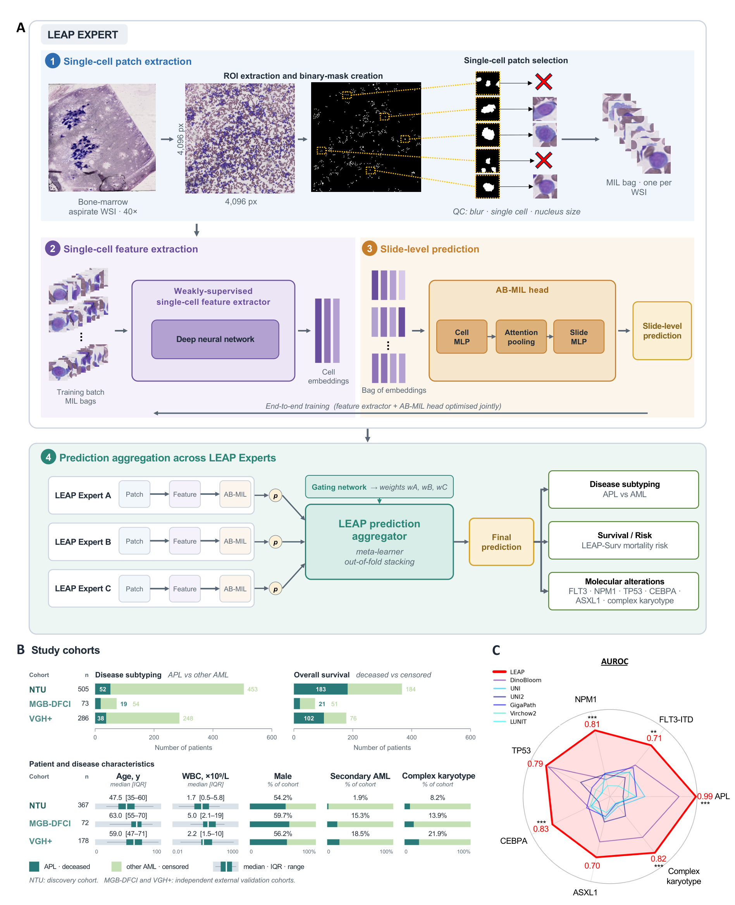

# LEAP — Leukemia End-to-End Analysis Platform

[](https://pytorch.org/)
[](LICENSE)

### Single-cell AI for bone marrow smear assessment in acute myeloid leukemia: a randomized reader study of clinician–AI collaboration
 
Larghero G^, Liu CJ^, Zhao J^, Tsai XCH^, Liu YC, Engel C, Kao TW, Vremenko D, Ji-Xu A, Shanmugan V, Yuan W, Chen HR, Hong YC, Tsai CK, Teng CL, Yu YB, Jackson C, Zhang Y, Lin YH, Zhu M, Xiao Q, Schiefer AI, Munjal K, Chen D, Hou HA, Tien HF, Chou WC, How J, Connors JM, Stahl M, Yu KH+.
 
*^These authors contributed equally to this manuscript. +Correspondence to Kun-Hsing Yu.*
 
*Lead Contact: Kun-Hsing Yu, M.D., Ph.D.*
 
#### ABSTRACT
 
Acute myeloid leukemia (AML) assessment increasingly integrates morphological and molecular information, yet the capacity of artificial intelligence (AI) to extract these signals from bone marrow smears remains unclear. Rapid recognition is particularly critical for acute promyelocytic leukemia (APL), an AML subtype requiring immediate initiation of all-trans retinoic acid while molecular confirmation is pending. To address this urgent diagnostic need and advance broader AML evaluation, we developed and validated the Leukemia End-to-End Analysis Platform (LEAP), a single-cell AI framework that analyzes routine bone marrow smears from patients with newly diagnosed AML for subtyping, survival stratification, and molecular alteration prediction. Using whole-slide images (WSIs) from six institutions, LEAP achieved an AUROC of 0.994 (95% CI 0.987–0.999) for distinguishing APL from other AML subtypes, significantly outperforming all comparator pathology and hematopathology foundation models. In a prospectively registered randomized reader study (NCT07203885), LEAP assistance increased sensitivity by 29.2 percentage points (95% CI 13.5–44.9 percentage points), accuracy by 5.6 percentage points, PPV by 17.6 percentage points, and NPV by 4.0 percentage points. A multimodal model integrating LEAP-derived features with routine clinical variables predicted overall survival across all cohorts (concordance index 0.66–0.80; log-rank *P* < 0.0001), and LEAP identified six clinically relevant genomic alterations from whole-slide images alone (AUROC 0.70–0.83). These findings demonstrate that a domain-specific, single-cell AI framework can extract diagnostic, prognostic, and molecular signals from standard bone marrow smears in AML and enhance clinicians' recognition of time-critical subtypes.
 
<p align="center">
  
</p>

## Installation

```
conda env create -f environment.yml
conda activate leap
```

Run everything from the repository root, so that `import leap` resolves.

## Input data contract

Three inputs. Nothing else about your filesystem is assumed, and every path is a config key.

**Patch archives.** One zip per slide, named for its slide identifier:

```
<image_folder>/
├── SLIDE_0001.zip
├── SLIDE_0002.zip
└── ...
```

Each archive holds one PNG per cell, at the top level or in subdirectories; only the `.png`
suffix matters and filenames are otherwise free. Names are sorted before sampling, so ordering is
stable. Patches are resized to 96×96 and normalised with ImageNet statistics, so the crops
themselves may be any size. Each bag draws `patches_per_slide` patches; a slide with fewer is
zero-padded to that length, and a slide with more is subsampled deterministically and re-drawn each epoch during training.

**Label file.** One spreadsheet (`.xlsx`), one row per slide:

| column | type | meaning |
|---|---|---|
| `Slide_ID` | string | must match the zip basename exactly, and be unique |
| *your label column* | integer, 0 or 1 | the classification target; name it in `data.label_column` |

For survival, the same format with two columns instead of a label:

| column | type | meaning |
|---|---|---|
| `Slide_ID` | string | as above |
| *time column* | float | follow-up time, in whatever unit you report |
| *event column* | 0 or 1 | 1 if the event was observed, 0 if censored |

Every **other** column in a survival label file is treated as a clinical covariate for the
second-stage Cox model, and rows with any missing covariate are dropped from that model. So point
`cohorts.*.label_file` at a file containing only the covariates you intend to adjust for. All
cohorts must share the same covariate columns.

**Split file.** JSON, keyed by slide identifier so that an edit to the spreadsheet cannot
reshuffle folds. `scripts/train_expert.py` creates it on first run if `data.split_json` does not
exist, using stratified k-fold with a stratified inner validation split; write your own to control
the partition:

```json
{
  "label_file": "labels.xlsx",
  "label_column": "TARGET",
  "n_folds": 5,
  "seed": 42,
  "val_frac": 0.25,
  "folds": {
    "0": {"train": ["SLIDE_0002", "..."], "val": ["SLIDE_0031", "..."], "test": ["SLIDE_0007", "..."]},
    "1": {"train": ["..."], "val": ["..."], "test": ["..."]}
  }
}
```

Every identifier listed must be present in the label file; a mismatch aborts the run rather than
silently dropping slides. Only the `folds` block is read.

## Usage

Each task is one script and one config. The configs in `configs/` are blank templates: fill in
the keys you need. Any key can be overridden on the command line with `--set key=value`.

### 1. Train an Expert

```
python scripts/train_expert.py --config configs/train_expert.yaml
```

Trains one backbone across all folds. Per fold it selects the best epoch on validation, writes
that checkpoint to `output.checkpoint_dir` as `<experiment_id>_fold<k>.pt` — where
`<experiment_id>` is `<experiment_name>.<extractor class>.<head class>`
Under `output.results_dir` it writes, per cohort, `<experiment_id>_fold_<k>.csv` with one row per slide

Run it once per backbone, changing `extractor._target_`, `head.in_features`,
`head.d_model_attention` and `experiment_name`. `in_features` must equal the extractor output
dimension: 4096 for VGG19, 2048 for ResNet50, 1024 for DenseNet121.

### 2. Aggregate the Experts

```
python scripts/ensemble.py --config configs/ensemble.yaml
```

CPU only: it reads the Experts' prediction CSVs. Evaluates each single Expert on the discovery cohort and on each
zero-shot cohort, and reports the one named by `headline`. Writes, under
`output.results_dir/<experiment_name>/`, `combiner_comparison.csv` (every model × cohort, with
bootstrap confidence intervals), `ensemble_recap.csv`, the reported model's per-fold predictions
in `<cohort>/ensemble_fold_<k>.csv`, and every other model's under `by_model/`.

To sweep several targets, loop in the shell:

```
for target in TARGET_A TARGET_B; do
  python scripts/ensemble.py --config configs/ensemble.yaml --set data.label_column=$target
done
```

### 3. Survival modelling

```
python scripts/survival.py --config configs/survival.yaml
```

Loads each Expert's checkpoint, embeds every slide of every cohort, standardises on the discovery
cohort, fits one Cox-loss MLP per Expert, combines their risks in a Cox model to give the
pathology risk score, then adds the clinical covariates in a second Cox model. Writes tables
only, under `output.results_dir/<experiment_name>/tables/`: `patients.csv` (one row per cohort ×
fold × slide, with every risk score and covariate).


## Data and model availability

No data and no model weights are distributed with this repository. Trained checkpoints, slide and
cell embeddings, cross-validation splits, and patient data are not included, and no slide or
patient identifier appears anywhere in it. Those materials are available to reviewers via the
Zenodo record [10.5281/zenodo.17728421](https://doi.org/10.5281/zenodo.17728421), or from the
corresponding author on reasonable request.

## Citation

See `CITATION.cff`.

## License

MIT, `LICENSE`. The attention-MIL head in `leap/nn/` is adapted from Owkin's HistoSSLscaling
(<https://github.com/owkin/HistoSSLscaling>) and is governed by that project's terms; see the
module docstrings in `leap/nn/`.

## Intended use

LEAP is a research tool. It is not a medical device, has not been approved or cleared by any
regulatory body, and must not be used to inform clinical decisions or patient care.
